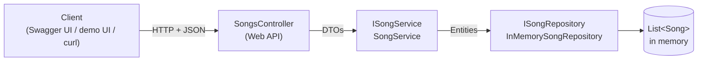

# Playlist API – SE4458 Assignment 2

A simple REST API for managing a music playlist, built with **.NET 8 Web API**, using an **in-memory data store**, documented with **Swagger (OpenAPI)** and deployed on **Render**.

**Course:** SE4458 Software Architecture & Design of Modern Large Scale Systems
**Group:** Group 2 – Playlist
**Student:** Bermal Deniz Akkaya

| | Link |
|---|---|
| Source code | https://github.com/deensza/se4458-playlist-api |
| Live API (Swagger) | https://se4458-playlist-api.onrender.com/swagger |
| Health check | https://se4458-playlist-api.onrender.com/api/v1/health |
| Optional demo UI | https://se4458-playlist-api.onrender.com/app/ |

> The service runs on Render's free plan. If nobody has used it for 15 minutes it goes to sleep, so the **first request can take 30–60 seconds**. After that it responds normally.

---

## Features

The endpoints cover everything on the playlist screen given in the assignment:

| Screen element | API |
|---|---|
| Song list, "5 songs • 17 min 26 sec" header | `GET /api/v1/songs` (returns items + `summary`) |
| Search songs, artist or album | `GET /api/v1/songs?search=weeknd` |
| Sort by (Title A–Z, Artist, Duration…) | `GET /api/v1/songs?sortBy=Title&sortOrder=Asc` |
| "All Genres" filter | `GET /api/v1/songs?genre=Pop`, list of genres: `GET /api/v1/songs/genres` |
| Favorite star | `PUT` / `DELETE /api/v1/songs/{id}/favorite`, filter: `?isFavorite=true` |
| Edit (pencil) | `PUT /api/v1/songs/{id}` |
| Remove song dialog | `DELETE /api/v1/songs/{id}` |
| Add (+) button | `POST /api/v1/songs` |
| Drag & drop reorder | `PUT /api/v1/songs/{id}/position` |
| Pagination | `GET /api/v1/songs?page=1&pageSize=20` |

### Endpoints

| Method | Route | Description | Success | Errors |
|---|---|---|---|---|
| GET | `/api/v1/songs` | List with search, genre / favorite filter, sorting, pagination and summary | 200 | 400 |
| GET | `/api/v1/songs/genres` | Distinct genres | 200 | |
| GET | `/api/v1/songs/{id}` | Get one song | 200 | 404 |
| POST | `/api/v1/songs` | Add a song to the end of the playlist | 201 + `Location` | 400 |
| PUT | `/api/v1/songs/{id}` | Edit a song (replaces all editable fields) | 200 | 400, 404 |
| DELETE | `/api/v1/songs/{id}` | Remove a song | 204 | 404 |
| PUT | `/api/v1/songs/{id}/favorite` | Mark as favorite | 200 | 404 |
| DELETE | `/api/v1/songs/{id}/favorite` | Remove from favorites | 200 | 404 |
| PUT | `/api/v1/songs/{id}/position` | Move to a new position, body `{ "position": 1 }` | 200 | 400, 404 |
| GET | `/api/v1/health` | Health check | 200 | |

Query parameters of `GET /api/v1/songs`:

| Parameter | Values | Default |
|---|---|---|
| `search` | text, searched in title, artist and album (case-insensitive) | – |
| `genre` | e.g. `Pop`, `R&B` (case-insensitive) | all |
| `isFavorite` | `true` / `false` | all |
| `sortBy` | `Position`, `Title`, `Artist`, `Album`, `Duration`, `Genre`, `CreatedAt` | `Position` |
| `sortOrder` | `Asc`, `Desc` | `Asc` |
| `page` | ≥ 1 | 1 |
| `pageSize` | 1 – 100 | 20 |

Example response of `GET /api/v1/songs?pageSize=2`:

```json
{
  "items": [
    { "id": 1, "title": "Blinding Lights", "artist": "The Weeknd", "album": "After Hours",
      "durationSeconds": 212, "duration": "3:32", "genre": "Pop", "coverImageUrl": null,
      "isFavorite": true, "position": 1, "createdAt": "…", "updatedAt": "…" },
    { "id": 2, "title": "Levitating", "artist": "Dua Lipa", "…": "…" }
  ],
  "page": 1, "pageSize": 2, "totalCount": 5, "totalPages": 3,
  "summary": { "songCount": 5, "totalDurationSeconds": 1046, "totalDuration": "17 min 26 sec" }
}
```

---

## Design

The structure follows the layered class diagram from the lecture (Controller → Service interface → Data access, with Dependency Injection and DTOs):



| Lecture diagram | This project |
|---|---|
| `CourseControllerWebAPI` | `Controllers/SongsController.cs` |
| `ICourseService` / `CourseService` | `Services/ISongService.cs` / `Services/SongService.cs` |
| `CourseAccess` | `Data/ISongRepository.cs` / `Data/InMemorySongRepository.cs` |
| `CourseModel` | `Models/Song.cs` |
| `CourseDTO` | `DTOs/SongDtos.cs`, `DTOs/QueryDtos.cs` |

```
src/PlaylistApi/
├── Controllers/   SongsController, HealthController
├── Services/      ISongService, SongService (business logic: search, sort, paging, reorder)
├── Data/          ISongRepository, InMemorySongRepository (thread-safe List<Song>)
├── Models/        Song (entity)
├── DTOs/          request / response models and query parameters
├── wwwroot/app/   optional demo UI (single HTML file)
└── Program.cs     DI registrations, Swagger, PORT handling
Dockerfile         multi-stage build used by Render
```

### Design decisions

- **Layers and Dependency Injection.** The controller only knows `ISongService`, the service only knows `ISongRepository`. The repository is registered as a **Singleton** (one shared in-memory list), the service as **Scoped**. Replacing the in-memory store with a real database would only need a new repository class.
- **Entity vs DTO.** Clients never send or receive the `Song` entity directly. `Id`, `Position`, `CreatedAt` and `UpdatedAt` are set by the server and cannot be posted.
- **REST naming.** Plural noun resources (`/songs`), no verbs in URLs, sub-resources for actions on a song (`/songs/{id}/favorite`, `/songs/{id}/position`).
- **Versioning.** All routes start with `/api/v1` so a future v2 can live next to v1.
- **Idempotency.** `PUT` replaces all editable fields. Favorites use `PUT` (add) and `DELETE` (remove) instead of a toggle, so repeating a request never flips the state back. Moving a song to the same position twice gives the same order.
- **Search as query parameters.** Search, filter, sort and paging are query parameters of the same `GET /songs` collection rather than a separate `/search` endpoint, because they all return the same resource.
- **Pagination with summary.** The list is paged (max 100 per page). The `summary` (count and total length) is calculated over **all songs that match the filters**, not only the current page, so it can be shown as the playlist header.
- **Validation and errors.** Data annotations validate the request bodies and query parameters (`[ApiController]` returns `400` automatically). Every error, including `404` and unexpected `500`s, is returned in the standard **ProblemDetails** JSON format.
- **Thread safety.** The in-memory list is protected with a `lock`, and the repository returns copies so callers cannot change stored data without going through it.
- **Swagger.** Enabled in every environment (the assignment requires a public Swagger page). XML comments, response codes and example values are shown in Swagger. Opening the root URL redirects to `/swagger`.

### Assumptions

- Data is kept **only in memory**, as the assignment requires. It resets to the 5 sample songs from the assignment screen whenever the app restarts (on Render this also happens after the free instance goes to sleep or is redeployed).
- There is **one playlist**, so songs are the top-level resource.
- **No authentication**, since the assignment does not ask for users or login.
- Duration is stored in **seconds** (1 – 3600). The API also returns a formatted value such as `"3:32"`.
- Genre is free text (e.g. "Pop", "R&B"); comparisons are case-insensitive.
- `position` is 1-based and always continuous (1, 2, 3, …). New songs are added to the end; deleting a song closes the gap.
- Cover images are optional URLs; the API does not upload or store image files.

---

## Optional demo UI

The assignment only asks for the API and Swagger. As an extra, `wwwroot/app/index.html` is a small single-file page (plain HTML/CSS/JavaScript, no framework) served at `/app/`. It uses only the public endpoints above: search, sort, genre and favorite filters, add / edit / remove, favorite star, drag-and-drop (and arrow-key) reordering, and a record graphic whose ring shows each song's share of the total length. The API does not depend on it.

---

## Running locally

Requirements: [.NET 8 SDK](https://dotnet.microsoft.com/download/dotnet/8.0)

```bash
git clone https://github.com/deensza/se4458-playlist-api.git
cd se4458-playlist-api/src/PlaylistApi
dotnet run
```

Then open http://localhost:5072/swagger (and http://localhost:5072/app/ for the demo UI).

With Docker:

```bash
docker build -t playlist-api .
docker run -p 8080:8080 playlist-api
# http://localhost:8080/swagger
```

## Deployment

Render → New Web Service → this GitHub repository, **Language: Docker**, **Free** instance, health check path `/api/v1/health`, auto-deploy on every commit to `main`. Render builds the `Dockerfile` (multi-stage: .NET 8 SDK for build, ASP.NET runtime image for running) and passes the port in the `PORT` environment variable, which `Program.cs` reads.

---

## Issues encountered

- **Swagger was only enabled in Development.** The .NET template turns Swagger on only for the Development environment, so it would not appear on the deployed site. It is now enabled in every environment and `/` redirects to it.
- **Render has no native .NET runtime.** Render does not offer .NET as a built-in language, so the app is deployed as a Docker image with a multi-stage `Dockerfile`.
- **Port binding.** Render assigns the port at runtime through the `PORT` variable. The app reads it and listens on `0.0.0.0:$PORT`; HTTPS redirection was removed because Render terminates TLS in front of the app.
- **Cold starts on the free plan.** The free instance sleeps after 15 minutes without traffic and the first request takes 30–60 seconds. Because data is in memory, it also resets to the sample songs after sleeping.
- **Reordering while filtered.** Moving a song inside a filtered or differently sorted list is ambiguous. The API always works with the absolute playlist position, and the demo UI only allows drag-and-drop in playlist order with no filters.
- **Enums in Swagger.** By default enums are shown as numbers (`0, 1, 2…`). A `JsonStringEnumConverter` makes `sortBy` / `sortOrder` appear and work as names (`Title`, `Desc`).
- **GitHub authentication.** Pushing from the terminal with the account password failed (`Password authentication is not supported`); a personal access token was needed.

## Testing

All endpoints were tested manually in Swagger and with an end-to-end script (26 checks: CRUD, validation errors, 404s, search, genre / favorite filters, sorting in both directions, pagination limits, favorites, reordering and continuous positions after delete). The demo UI was tested in a headless Chromium browser on desktop and mobile widths.
